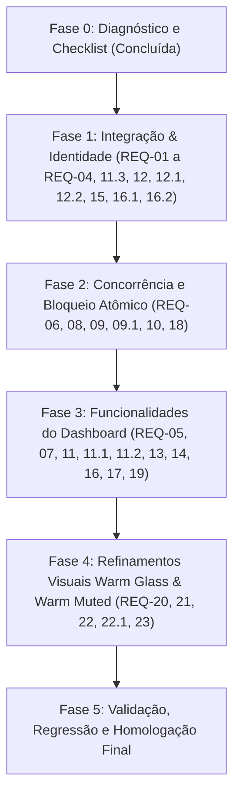

# AuditIA — Checklist e Diagnóstico Técnico do Dashboard Médico Auditor

**Documento:** `docs/implementation/DASHBOARD_CHECKLIST.md`  
**Data:** 26/11/2026  
**Branch:** `feature/aetherfield-design-system`  
**Checkpoint Base:** `7801fca`  
**Fonte da Especificação:** `docs/requirements/DASHBOARD.md` (Hash SHA-256 verificado: `BB7522E42EDCF9F7DAECB8910876A4CD4E39FDE777AFE01B3AB3FCD44715F8DA`)  
**Baseline Test Suite:** 137 testes aprovados (100% OK em 274.37s)

---

## A. Diagnóstico Técnico dos 12 Tópicos do Codebase

### 1. Esquema de Banco de Dados e Migrações
- **Estado:** IMPLEMENTADO (Infraestrutura de DDL e migrações incrementais automáticas existente)
- **Evidências:**
  - `mvp/backend/storage.py:50-240`: função `initialize()` executa scripts DDL `CREATE TABLE IF NOT EXISTS` e migrações idempotentes via `ALTER TABLE ADD COLUMN` inspecionando `PRAGMA table_info`.
  - `mvp/backend/app.py:957-961`: `initialize()` é chamado obrigatoriamente no startup do servidor WSGI.
  - `mvp/backend/storage.py:17` e `mvp/backend/app.py:959-960`: se `config.BETA` for verdadeiro, utiliza `auditia-beta.sqlite3`; no modo padrão (default), utiliza `auditia-governanca-demo.sqlite3`.
  - Tabelas mapeadas: `tenants`, `users`, `cases`, `documents`, `sync_jobs`, `catalog_versions`, `runs`, `reviews`, `audit_events`, `ai_terms_acceptances`, `auditor_profiles`, `auditor_disabled`, `telemetry`, `dut_documents`, `dut_sources`, `regulatory_rules`, `regulatory_gold`, `regulatory_events`, `regulatory_audits`, `session_acceptances`, `tuss_rol_versions`, `tuss_rol_mappings`, `tuss_rol_events`, `case_routes`, `out_of_rol_assessments`, `decisoes_demo`, `case_workflow`, `document_transcriptions`, `clinical_evidences`, `governance_audit_trail`, `regulatory_drafts`.
- **Lacuna:** O esquema atual não possui colunas para bloqueio atômico de caso (`assumed_by`, `locked_at`, `lock_expires_at`), fila de origem (`fila_origem` ou `localizacao` AMM/AMOP), data de encaminhamento de complementação documental (48h) nem campos para primeiro nome e tratamento formal ("Dra./Dr.") na tabela `users` ou `auditor_profiles`.
- **Dependência:** Migração incremental via `ALTER TABLE ADD COLUMN` em `storage.py:initialize()`.
- **Risco:** BAIXO (o mecanismo de migração via `PRAGMA table_info` já está consolidado e não quebra bases existentes).

---

### 2. Autenticação, RBAC e Isolamento Multi-tenant
- **Estado:** IMPLEMENTADO (Core) / PARCIAL (Campos de exibição do usuário)
- **Evidências:**
  - `mvp/backend/auth.py:48-73`: emissão e verificação de JWT HS256 assinado com claims obrigatórias (`user`, `tenant`, `tenant_name`, `role`, `csrf`, `iat`, `exp`, `jti`).
  - `mvp/backend/app.py:175-195`: rota `/entrar` com validação de senha PBKDF2-HMAC-SHA256 (600.000 iterações), proteção contra força bruta (máximo 8 tentativas por minuto), verificação de usuário desativado (`auditor_disabled`) e auditoria de evento.
  - `mvp/backend/app.py:196-209`: guarda de tenant no backend obrigatória (`tenant = session["tenant"]`), autorização estrita de perfis `auditor` vs `admin` e função de bloqueio `denied()`.
  - `mvp/backend/storage.py:248-255`: usuários gerados na inicialização: `auditor-aurora`, `admin-aurora`, `auditor-horizonte`, `admin-horizonte`.
  - `mvp/backend/storage.py:119-122`: tabela `auditor_profiles` contém `username`, `tenant`, `name`, `crm`, `uf`, `email`, `modified`.
- **Lacuna:** A tabela `users` armazena apenas `username`, `role` e hash. A tabela `auditor_profiles` armazena `name` completo e `crm`, mas não possui campos específicos para tratamento formal ("Dr./Dra.") ou primeiro nome higienizado para saudação personalizada (REQ-20).
- **Dependência:** Adicionar campos na tabela `auditor_profiles` ou normalizar a partir do `name` com fallback neutro caso ausente.
- **Risco:** BAIXO.

---

### 3. Atribuição de Casos, Bloqueio Atômico e Concorrência
- **Estado:** NÃO IMPLEMENTADO
- **Evidências:**
  - `mvp/backend/storage.py:170-174`: tabela `case_workflow` registra apenas `status IN ('ativo','gerencia','finalizado')`, `run_id`, `actor`, `updated_at`.
  - `mvp/backend/consultas.py:84, 97-98`: a coluna `medico_responsavel` é atualmente inferida de forma tardia a partir do autor da última revisão de conclusão (`LEFT JOIN reviews v ... ON v.stage='conclusao'`).
  - `mvp/backend/telas.py:520-527`: função `determinar_acao_primaria()` não valida quem é o usuário que está acessando o caso.
- **Lacuna:** Não existe trava de concorrência. Não há campos `assumed_by`, `locked_at`, `lock_expires_at`, rota de devolução à fila (`/caso/devolver`) nem mecanismo de expiração de bloqueio por inatividade (REQ-08, REQ-09, REQ-09.1).
- **Dependência:** Atualização de esquema em `storage.py` e validação transacional atômica no backend (`app.py`).
- **Risco:** ALTO (concorrência e integridade transacional sem concorrência destrutiva).

---

### 4. Integração e Sincronização (SIGO/Oracle, Filas AMM/AMOP)
- **Estado:** PARCIAL
- **Evidências:**
  - `mvp/backend/adapters.py:10-23`: define mapeamentos fictícios para `sigo`, `mv` e `tasy`.
  - `mvp/backend/sigo_simulado.py:13-207`: gerador do lote sintético do SIGO com casos clínicos, documentos com hash SHA-256 e transcrições completas.
  - `mvp/backend/sigo_simulado.py:210-260`: função `sincronizar_sigo_simulado()` com `SAVEPOINT`, registro em `sync_jobs` e trilha de governança.
  - `mvp/backend/app.py:423-434`: rota `POST /sincronizar` atualmente chama `storage.sync_demo()` genérico em vez do conector específico `sigo_simulado`.
  - `mvp/backend/telas.py:642-651`: interface já apresenta exclusivamente o card "Integração com a operadora — SIGO/Oracle", ocultando MV e TASY da tela.
- **Lacuna:** Não há suporte às filas `AMM` e `AMOP` (REQ-04/12). A regra de entrada exclusiva por AMM e a regra de saída REQ-16.1 não estão implementadas. Falta mecanismo de sincronização periódica segura em segundo plano com guarda de concorrência e timestamp de última sincronização bem-sucedida para o dashboard (REQ-15).
- **Dependência:** Adaptação de `sigo_simulado.py`, `storage.py` e rotinas de background.
- **Risco:** ALTO (regras de entrada e saída determinísticas sem perda de dados históricos).

---

### 5. Terminologia, Triagem e Proveniência de Dados
- **Estado:** IMPLEMENTADO (Core) / PARCIAL (Variantes textuais e proveniência)
- **Evidências:**
  - `mvp/backend/tuss_rol.py:7-40`: tabela oficial de correlação TUSS × Rol da ANS (RN 465/2021, RN 679/2026, RN 680/2026) com versionamento e hash.
  - `mvp/backend/tuss_rol.py:48-60`: função `triagem()` classifica casos em `dut60_direta`, `dut60_correlacionada` ou `avaliacao_fora_rol`.
  - `mvp/backend/storage.py:65`: tabela `cases` preserva `tuss_code` e `associated_tuss_codes`.
- **Lacuna:** Mapeamento explícito de variantes textuais de PET-CT em pedidos não codificados ou divergentes (REQ-02, REQ-03) sem forçar DUT 60 em casos fora do escopo.
- **Dependência:** Expansão da função de triagem em `tuss_rol.py`.
- **Risco:** MÉDIO.

---

### 6. Documentos, Categorização e Prazos Operacionais
- **Estado:** IMPLEMENTADO (Classificação e Upload) / PARCIAL (Controle de 48h)
- **Evidências:**
  - `mvp/backend/criterios_dut.py:233-345`: função `categorizar_documentos_caso()` implementa separação do Eixo A (DUT regulatória estrita) e Eixo B (suficiência documental/recomendações).
  - `mvp/backend/app.py:476-512`: rota `POST /caso/documentos` para upload de `pedido_medico` e `anatomopatologico`.
  - `mvp/backend/storage.py:69-76`: tabela `documents` armazena `mime_type`, `local_path`, `content_text`, `content_blob`, `source_sha256` e `verification_status`.
- **Lacuna:** Falta campo para registro do encaminhamento operacional da solicitação de complementação documental e cálculo do prazo estimativo de 48h sem suspensão do SLA regulatório (REQ-11, REQ-11.1, REQ-11.2).
- **Dependência:** Coluna em `cases` ou tabela auxiliar de encaminhamentos documentais.
- **Risco:** MÉDIO.

---

### 7. SLA Regulatório (RN ANS nº 623/2024 e RN nº 566/2022)
- **Estado:** IMPLEMENTADO (Cálculo e Ordenação Base) / PARCIAL (Ordenação Interativa)
- **Evidências:**
  - `mvp/backend/datas.py:143-264`: função determinística `calcular_sla()` baseada em dias úteis no fuso `America/Sao_Paulo`, com calendário nacional `holidays`.
  - `mvp/backend/datas.py:18-23`: constantes `STATUS_PROTOCOLO_AUSENTE`, `STATUS_VENCIDO`, `STATUS_ALERTA`, `STATUS_NO_PRAZO`, `STATUS_CONCLUIDO_NO_PRAZO`, `STATUS_CONCLUIDO_FORA_PRAZO`.
  - `mvp/backend/consultas.py:101-103`: ordenação SQL base por protocolo (`ORDER BY (c.data_protocolo_operadora IS NULL) ASC, c.data_protocolo_operadora ASC, c.id ASC`).
- **Lacuna:** A tabela do dashboard precisa de controle de ordenação crescente/decrescente exclusivamente na coluna de Situação SLA (REQ-13, REQ-16), garantindo que protocolos ausentes fiquem sempre visíveis no grupo apropriado.
- **Dependência:** Parâmetro `ordem_sla` na query de `consultas.casos_da_operadora()`.
- **Risco:** BAIXO.

---

### 8. Auditoria, Governança e Trilha de Eventos
- **Estado:** IMPLEMENTADO
- **Evidências:**
  - `mvp/backend/storage.py:273-277`: função `audit()` grava em `audit_events`.
  - `mvp/backend/storage.py:189-196`: tabela `governance_audit_trail` com campos detalhados de governança.
  - `mvp/backend/app.py:232-233`: rotas `/trilha`, `/telemetria` e `/auditores` estritamente restritas a administradores (`if not admin: return denied(...)`).
- **Lacuna:** Nenhuma no backend. Médicos não possuem acesso a essas rotas, conforme exigido por REQ-06.
- **Dependência:** Nenhuma.
- **Risco:** BAIXO.

---

### 9. Estado Atual do Dashboard do Auditor
- **Estado:** PARCIAL
- **Evidências:**
  - `mvp/frontend/telas.py:545-684`: função `cases_page()` renderiza o painel de auditoria médica.
  - `mvp/frontend/telas.py:658-668`: possui apenas 4 cards estáticos (`Solicitações`, `Em análise`, `Revisão médica`, `Concluídas`).
  - `mvp/frontend/telas.py:594-611`: renderiza botão primário + menu de três pontos com ações secundárias ("Gerar parecer", "Finalizar caso").
  - `mvp/frontend/telas.py:631-641`: tabela com 9 colunas atuais (falta coluna "Localização" e há menu de três pontos a remover).
  - `mvp/tests/test_workflows.py:464-489`: testes automatizados que validam strings do dashboard.
- **Lacuna:** Faltam os 6 cards dinâmicos clicáveis com Warm Glass (REQ-07, REQ-22), filtros de período discreto, pesquisa unificada por código do beneficiário (REQ-14), 10 colunas na tabela (com "Localização" AMM/AMOP, REQ-16), botões contextuais únicos sem menu de três pontos e saudação personalizada (REQ-20).
- **Dependência:** Refatoração de `cases_page()` em `telas.py`, consultas auxiliares em `consultas.py` e estilos em `estilo.css`.
- **Risco:** ALTO (necessita preservar testes de regressão existentes sem quebrar layout).

---

### 10. Acionamento da Inteligência Artificial
- **Estado:** IMPLEMENTADO (Separação estrita de runtime)
- **Evidências:**
  - `mvp/backend/app.py:688-750`: a IA executa exclusivamente nas rotas `POST /parecer` e `POST /analisar`.
  - `mvp/backend/storage.py:311-360`: a função `import_records()` executa exclusivamente a ingestão cadastral e documental, sem qualquer chamada ao motor de IA.
  - `mvp/backend/sigo_simulado.py:210-260`: sincronização não dispara inferência automática.
- **Lacuna:** Nenhuma na ingestão. Apenas garantir que o fluxo de "Analisar" no dashboard direcione o médico para a assunção segura do caso antes do parecer (REQ-10).
- **Dependência:** Nenhuma.
- **Risco:** BAIXO.

---

### 11. Dados Demonstrativos e Casos Fictícios
- **Estado:** IMPLEMENTADO
- **Evidências:**
  - `mvp/backend/homologacao.py:13-24`: casos `B01` (linfoma, atende DUT 60.2.a), `B02` (dados insuficientes, diagnóstico ausente), `B07` (PET-CT cerebral/demência, fora do Rol).
  - `mvp/backend/app.py:398, 403`: casos `B01` a `B10` são carregados na fila do modo BETA.
  - `mvp/backend/sigo_simulado.py:47-206`: casos sintéticos para o conector SIGO na operadora Aurora Saúde.
- **Lacuna:** Garantir que os casos equivalentes a `B01`, `B02` e `B07` estejam presentes no lote do SIGO do banco padrão `auditia-governanca-demo.sqlite3` para permitir a validação completa sem necessidade do modo BETA.
- **Dependência:** Inclusão/ajuste no lote de `sigo_simulado.py`.
- **Risco:** MÉDIO.

---

### 12. Tela Individual do Caso (`/caso/<id>`)
- **Estado:** IMPLEMENTADO
- **Evidências:**
  - `mvp/frontend/telas.py:350-512`: tela individual expõe "Gerar parecer", "Registrar revisão médica", "Minutas regulatórias", histórico de revisões e formulário de upload de documentos faltantes (`/caso/documentos`).
  - `mvp/backend/app.py:437-450`: rota `POST /caso/finalizar` disponível para o médico responsável.
- **Lacuna:** Adicionar à tela individual a ação de "Devolver à fila" (REQ-08) e assegurar que, ao remover o menu de três pontos do dashboard, nenhuma funcionalidade clínica fique inacessível.
- **Dependência:** Rota `/caso/devolver` no backend e botão correspondente na tela do caso.
- **Risco:** BAIXO.

---

## B. Matriz de Rastreabilidade dos 23 Requisitos

| REQ | Estado | Evidência Atual | Arquivos Impactados | Dependências | Critério de Aceitação | Teste Necessário | Risco | Fase |
| :---: | :---: | :--- | :--- | :--- | :--- | :--- | :---: | :---: |
| **REQ-01** | IMPLEMENTADO | `consultas.py:126`, `telas.py:657` | `consultas.py`, `telas.py` | JWT, RBAC | Fila da Aurora compartilhada entre auditores; isolamento entre tenants mantido no backend; produtividade individual apurada por auditor autenticado sem dupla contagem ou dupla atribuição. | Teste de isolamento multi-tenant e apuração de produtividade individual (`test_produtividade_individual.py`). | MÉDIO | 1 |
| **REQ-02** | IMPLEMENTADO | `tuss_rol.py:48-89` | `tuss_rol.py` | TUSS × Rol | Variantes de grafia do PET-CT identificadas; mapeamento oficial TUSS/Rol/DUT preservado; ausência de histórico oncológico isoladamente não gera divergência cadastral; sugestão de código sem equivalência automática. | Teste unitário de triagem com variantes textuais e códigos TUSS (`test_fase1_integracao.py`). | MÉDIO | 1 |
| **REQ-03** | IMPLEMENTADO | `sigo_simulado.py:48-98`, `storage.py:336` | `storage.py`, `sigo_simulado.py` | Schema `cases` | Código, tabela e descrição originais preservados; dados mínimos essenciais e proveniência registrados sem replicação desnecessária. | Teste de persistência e integridade de proveniência na ingestão. | BAIXO | 1 |
| **REQ-04** | IMPLEMENTADO | `sigo_simulado.py:218`, `storage.py:323-382` | `sigo_simulado.py`, `storage.py` | Conector SIGO | Conector lógico simulado unidirecional; leitura exclusiva das fontes AMM e AMOP; exclusão total de AUD; nova guia entra exclusivamente pela primeira presença na AMM. | Teste de importação: rejeitar guia inédita em AMOP; aceitar via AMM; ignorar AUD (`test_fase1_integracao.py`). | ALTO | 1 |
| **REQ-05** | IMPLEMENTADO | `consultas.py:86`, `telas.py:560` | `storage.py`, `consultas.py`, `telas.py` | Schema, Workflow | Divergência confirmada pelo médico direcionada para card de Pendências de Codificação; permanece operacional enquanto na AMM/AMOP; qualquer médico pode acompanhar. | Teste de transição para pendência de codificação e contagem no card (`test_fase34_dashboard.py`). | ALTO | 3 |
| **REQ-06** | IMPLEMENTADO | `storage.py:275-540`, `app.py:207-234` | `app.py`, `storage.py` | `governance_audit_trail` | Ações registradas no backend com autoria e timestamps; logs e trilha acessíveis exclusivamente por perfil admin; médico vê apenas dados operacionais/clínicos. | Teste de RBAC: auditor recebe 403 em `/trilha` e `/telemetria`. | BAIXO | 2 |
| **REQ-07** | IMPLEMENTADO | `telas.py:785-800`, `consultas.py:115` | `telas.py`, `consultas.py`, `app.py` | Schema, Consultas | Seis cards dinâmicos funcionais (Solicitações, Aguardando análise, Em análise, Pendências codificação, Pendências documentais, Concluídas); clique filtra tabela; contagens dinâmicas. | Teste de renderização dos 6 cards e filtragem da tabela por card ativo (`test_fase34_dashboard.py`). | ALTO | 3 |
| **REQ-08** | IMPLEMENTADO | `storage.py:733-772`, `app.py:454-463` | `storage.py`, `app.py`, `telas.py` | Schema `cases` | Ao clicar "Analisar", bloqueio atômico do caso pelo auditor; somente o responsável edita e finaliza; demais auditores têm acesso somente leitura. | Teste de concorrência: tentativa simultânea e bloqueio de edição por auditor sem posse (`test_fase2_concorrencia.py`). | CRÍTICO | 2 |
| **REQ-09** | IMPLEMENTADO | `storage.py:795-827`, `app.py:464-472` | `app.py`, `storage.py`, `telas.py` | Bloqueio atômico | Médico responsável pode devolver caso à fila na tela individual, preservando análises anteriores e prazo regulatório; caso fica disponível para outro auditor. | Teste de devolução: verificar liberação de trava e histórico preservado (`test_fase2_concorrencia.py`). | ALTO | 2 |
| **REQ-09.1** | IMPLEMENTADO | `storage.py:705-731`, `storage.py:774-793` | `storage.py`, `app.py` | Bloqueio atômico | Liberação automática de bloqueio por inatividade após 60 min (parâmetro configurável no backend); renovação mediante atividade válida; proteção contra perda de rascunhos e rejeição de submissão com trava expirada. | Teste unitário de expiração de trava (60 min) e renovação ativa (`test_fase2_concorrencia.py`). | MÉDIO | 2 |
| **REQ-10** | IMPLEMENTADO | `app.py:728-745`, `storage.py:311` | `app.py` | Motor DUT 60 | IA executa exclusivamente após assunção médica e acionamento na tela do caso; nenhuma inferência automática durante importação/sincronização. | Teste de importação: verificar que tabela `runs` não sofre inserções. | BAIXO | 2 |
| **REQ-11** | IMPLEMENTADO | `criterios_dut.py:233`, `telas.py:570` | `telas.py`, `consultas.py` | Eixo A / Eixo B | Card próprio de Pendências Documentais; identificação de documentos faltantes com separação rigorosa entre Eixo A e Eixo B; conferência médica preservada. | Teste de filtragem por pendências documentais e integridade das categorias. | MÉDIO | 3 |
| **REQ-11.1** | IMPLEMENTADO | `storage.py:848`, `datas.py:251`, `telas.py:307` | `storage.py`, `app.py`, `datas.py` | Schema `cases` | Registro de encaminhamento operacional de complementação com prazo de 48h; prazo não suspende SLA regulatório da ANS nem gera negativa automática. | Teste de registro de encaminhamento e contagem de prazo sem impacto no SLA ANS (`test_fase34_dashboard.py`). | MÉDIO | 3 |
| **REQ-11.2** | IMPLEMENTADO | `datas.py:251`, `telas.py:555` | `datas.py`, `telas.py` | Prazo 48h | Vencimento do prazo operacional de 48h sinaliza ação "Reavaliar" no dashboard; chegada de novos documentos sinaliza ação "Reanalisar". | Teste unitário de determinação da ação contextual após 48h ou novos docs (`test_fase34_dashboard.py`). | MÉDIO | 3 |
| **REQ-11.3** | IMPLEMENTADO | `sigo_simulado.py:42-212`, `storage.py:416-470` | `sigo_simulado.py`, `storage.py` | Anexos binários | Sincronização e preservação de documentos binários originais (PDFs, imagens) com SHA-256 e visualização segura inline/download. | Teste de integridade de download binário e validação de hash SHA-256 (`test_fase1_integracao.py`). | BAIXO | 1 |
| **REQ-12** | IMPLEMENTADO | `storage.py:364-375` | `storage.py` | Transações SQLite | Sincronização com monitoramento contínuo de AMM e AMOP; registro único por guia; consolidação de histórico em caso de movimentação entre setores. | Teste de movimentação da guia entre AMM e AMOP com idempotência cadastral (`test_fase1_integracao.py`). | ALTO | 1 |
| **REQ-12.1** | IMPLEMENTADO | `app.py:430-450` | `app.py` | Background lock | Guarda de concorrência com rejeição (409 Conflict) contra execuções simultâneas duplicadas no mesmo tenant. | Teste de execução concorrente: tentativa de disparar sync simultâneo (`test_fase1_integracao.py`). | ALTO | 1 |
| **REQ-12.2** | IMPLEMENTADO | `storage.py:486-498`, `sigo_simulado.py:225-245` | `sigo_simulado.py`, `storage.py` | Savepoints DB | Tratamento de falhas parciais e consultas incompletas com rollback seguro e sem exclusão indevida de guias pré-existentes. | Teste de injeção de falha: verificar rollback de savepoint e registro de erro. | BAIXO | 1 |
| **REQ-13** | IMPLEMENTADO | `datas.py:143`, `consultas.py:100`, `telas.py:740` | `consultas.py`, `telas.py` | Cálculo SLA | Ordenação padrão por urgência de SLA (vencidos, alerta, no prazo, protocolo ausente); suporte a ordenação interativa exclusivamente na coluna SLA. | Teste de ordenação crescente e decrescente pela coluna de SLA. | MÉDIO | 3 |
| **REQ-14** | IMPLEMENTADO | `consultas.py:80`, `telas.py:815` | `consultas.py`, `telas.py` | Query SQL | Campo único de pesquisa por código do beneficiário; sem buscas por nome ou número da guia; respeito integral ao isolamento da operadora. | Teste de busca: pesquisar código exato e verificar isolamento multi-tenant (`test_fase34_dashboard.py`). | MÉDIO | 3 |
| **REQ-15** | IMPLEMENTADO | `telas.py:672-688` | `telas.py`, `consultas.py` | `sync_jobs` | Exibição do timestamp da última sincronização bem-sucedida e botão de acionamento manual de importação no card colapsável de integração. | Teste de renderização do timestamp da última sincronização. | MÉDIO | 1 |
| **REQ-16** | IMPLEMENTADO | `telas.py:730-750`, `estilo.css:2420` | `telas.py`, `estilo.css` | Tabela HTML | Tabela com 10 colunas (incluindo Localização AMM/AMOP); remoção do menu de três pontos; botão contextual único funcional conforme estado da guia. | Teste de integridade de colunas e validação dos rótulos de ações contextuais. | ALTO | 3 |
| **REQ-16.1** | IMPLEMENTADO | `sigo_simulado.py:248-268`, `consultas.py:43` | `sigo_simulado.py`, `consultas.py`, `storage.py` | Sync AMM/AMOP | Retirar a guia com análise finalizada da fila ativa somente após ausência confirmada simultaneamente em AMM e AMOP, mediante sincronização válida e completa; preservar integralmente histórico, parecer, status clínico e rastreabilidade. | Teste de saída de fila: confirmar ausência bilateral e retirada da fila ativa (`test_fase1_integracao.py`). | ALTO | 1 |
| **REQ-16.2** | IMPLEMENTADO | `storage.py:338-363` | `storage.py` | Desduplicação | Reativação de guia prévia ao reaparecer em AMM ou AMOP mediante validação cumulativa de operadora, guia, beneficiário, data original e hash integral do pedido médico. | Teste de reativação cumulativa e bloqueio com apontamento de divergência (`test_fase1_integracao.py`). | ALTO | 1 |
| **REQ-17** | IMPLEMENTADO | `consultas.py:75-110`, `telas.py:725` | `consultas.py`, `telas.py`, `app.py` | Concorrência | Permissão para auditor antecipar e atuar diretamente sobre guias presentes na AMOP (além da AMM), com controle de concorrência e SLA. | Teste de assunção de guia em localização AMOP por médico auditor. | MÉDIO | 3 |
| **REQ-18** | IMPLEMENTADO | `storage.py:733-772` | `app.py`, `storage.py` | Bloqueio atômico | Qualquer médico disponível pode assumir a reanálise de caso com novos documentos ou prazo vencido, preservando o histórico do responsável original. | Teste de continuidade: auditor B assume reanálise iniciada por auditor A (`test_fase2_concorrencia.py`). | MÉDIO | 2 |
| **REQ-19** | IMPLEMENTADO | `consultas.py:380`, `telas.py:805` | `consultas.py`, `telas.py` | Datas, Filtros | Filtro por períodos discretos (Hoje, Últimos 7 dias, Mês atual, Personalizado); contagem de produtividade individual (Concluídas) sem esconder pendências ativas. | Teste de filtro por período e assertividade na contagem individual (`test_fase34_dashboard.py`). | MÉDIO | 3 |
| **REQ-20** | IMPLEMENTADO | `storage.py:710`, `telas.py:830` | `telas.py`, `consultas.py` | Auditor Profile | Saudação personalizada com primeiro nome e tratamento cadastrado ("Dra./Dr."), com fallback neutro se não configurado; sem alteração da altura visual. | Teste de saudação: validar renderização para usuário com e sem perfil preenchido (`test_fase34_dashboard.py`). | BAIXO | 4 |
| **REQ-21** | IMPLEMENTADO | `telas.py:640-660` | `telas.py`, `consultas.py` | Consultas SQL | Coluna "Médico auditor" exibe "Responsável atual" quando em análise, "Última análise" quando aguardando/pendente, ou travessão se nunca analisada. | Teste de renderização da coluna com os 3 estados de responsabilidade médica. | BAIXO | 4 |
| **REQ-22** | IMPLEMENTADO | `estilo.css:2365`, `telas.py:790` | `estilo.css`, `telas.py` | Design Tokens | Estilização Warm Glass (.glass-panel) aplicada exclusivamente aos 6 cards e bloco de integração; destaque amarelo (.glass-panel--highlight) em Pendências documentais. | Validação visual e teste de propriedades CSS (backdrop-filter, borders). | MÉDIO | 4 |
| **REQ-22.1** | IMPLEMENTADO | `estilo.css:2370` | `estilo.css` | CSS puro | Gradiente de fundo do dashboard (#E4DBCF, #F5F1EB, #E9DFD1); preservação das demais telas (landing, login, termo, admin) sem alteração visual. | Teste de regressão visual em landing page e tela de login. | BAIXO | 4 |
| **REQ-23** | IMPLEMENTADO | `estilo.css:2450`, `telas.py:565` | `estilo.css`, `telas.py` | Paleta Muted | Badges de status com tokens funcionais Warm Muted com contorno (#F7F3E6 com cores específicas para cada um dos 7 estados) e conformidade WCAG AA. | Teste de classes CSS de badges e verificação automatizada de contraste WCAG. | MÉDIO | 4 |

---

## C. Diagnóstico de Segurança, Governança e Regulação Clínica

### 1. Controles Existentes (Comprovados por Código e Testes)
- **Supervisão Médica Humana Indelegável:** A IA não toma decisões nem altera status de casos de forma autônoma. O aceite obrigatório do termo `CFM-2454-2026-v1` é imposto antes do acesso clínico (`app.py:210-230`).
- **Preservação da CSP e Zero Estilos Inline:** CSP estrita configurada em `app.py:27-31` (`default-src 'self'; style-src 'self'; script-src 'self'; frame-ancestors 'none'; form-action 'self'; base-uri 'none'`). Nenhuma tag `<style>` ou atributo `style="..."` é admitido.
- **Isolamento Multi-tenant e RBAC:** Todas as queries filtram obrigatoriamente por `tenant_id` (`storage.py`, `consultas.py`). Tentativas de acesso entre operadoras geram 403 Forbidden e registro de auditoria (`audit_events`).
- **Cálculo Determinístico de SLA:** Implementado em `datas.py` segundo a RN ANS nº 623/2024, baseado exclusivamente em `data_protocolo_operadora` e dias úteis bancários nacionais.
- **Separação Clínica Eixo A vs Eixo B:** Implementada em `criterios_dut.py`, impedindo bloqueio indevido por ausência de biópsia em subitens da DUT 60 que não a exigem expressamente.

### 2. Lacunas Comprovadas no Escopo dos Requisitos
- **Ausência de Bloqueio Atômico na Aplicação:** Dois auditores podem abrir simultaneamente o mesmo caso `/caso/<id>` e submeter análises conflitantes, gerando risco de condição de corrida (`race condition`) e perda de histórico de autoria (REQ-08).
- **Inexistência de Rota de Devolução:** Um médico não possui botão na interface para devolver um caso assumido de volta à fila de atendimento sem emitir conclusão (REQ-09).
- **Falta de Diferenciação de Origem AMM vs AMOP:** O conector atual não rastreia de qual fila a guia se originou, impossibilitando aplicar a regra de exclusão de AMOP inédita e a regra de saída bilateral da fila (REQ-04, REQ-16.1).
- **Menu de Três Pontos Não Autorizado no Dashboard:** A presença das ações "Gerar parecer" e "Finalizar caso" na tabela do dashboard viola o princípio de ação contextual única e induz finalizações sem visualização prévia das evidências clínicas (REQ-16).

### 3. Decisões Homologadas pela Product Owner (Microetapa 0.3)
- **REQ-09.1 — Bloqueio por Inatividade (Homologado):**
  - Expiração automática após **60 minutos de inatividade**.
  - Parâmetro configurável no backend (default: 60 minutos).
  - Renovação automática do bloqueio mediante atividade médica válida no caso.
  - Proteção estrita contra perda de rascunhos e rejeição de submissão quando a trava estiver expirada, sem perda de dados digitados.
- **REQ-16.1 — Ausência de Guia no SIGO e Saída da Fila (Homologado):**
  - Retirar a guia com análise finalizada da fila ativa **somente após ausência confirmada simultaneamente em AMM e AMOP**, mediante sincronização válida e completa.
  - Preservação integral do histórico, parecer emitido, status clínico da análise e rastreabilidade na trilha de governança.
- **Mecanismo de Comunicação Documental (Escopo Mantido):** A solicitação de complementação documental é exclusivamente manual nesta fase (validação médica com envio manual ao operacional). Automação futura via WhatsApp/e-mail permanece fora do escopo da Beta 0.2 (REQ-11, REQ-11.3).

---

## D. Plano de Implementação Estruturado (Fases 1 a 5)

---

### Fase 1: Integração, Identidade e Sincronização Segura
- **Escopo:** REQ-01 (base), REQ-02, REQ-03, REQ-04, REQ-11.3, REQ-12, REQ-12.1, REQ-12.2, REQ-15, REQ-16.1, REQ-16.2.
- **Arquivos Previstos:**
  - `mvp/backend/storage.py` (migração de schema: colunas `localizacao_sigo`, `fila_origem`, `removido_origem_em`, `dados_pedido_hash`).
  - `mvp/backend/sigo_simulado.py` (geração de lotes com marcação AMM e AMOP; regras de entrada exclusiva por AMM e saída bilateral REQ-16.1; reativação REQ-16.2).
  - `mvp/backend/app.py` (ajuste da rota `/sincronizar` para acionar `sigo_simulado.sincronizar_sigo_simulado()`, timestamp de sucesso e bloqueio de concorrência no sync).
  - `mvp/backend/tuss_rol.py` (ampliação de tolerância a variantes textuais de PET-CT).
- **Dependências:** Conclusão da Fase 0.
- **Testes Direcionados:**
  - Ingestão exclusiva AMM vs AMOP inédita.
  - Teste de idempotência e preservação de histórico em movimentações.
  - Teste de saída da fila sob ausência simultânea comprovada.
  - Teste de reativação por correspondência integral dos 5 critérios.
- **Critérios de Conclusão:** Todas as sincronizações executam sem duplicações; nenhum caso entra apenas por AMOP; guias removidas não aparecem na fila ativa mas mantêm histórico.
- **Estratégia de Recuperação:** Rollback transacional via `SAVEPOINT` mantido em SQLite; em caso de falha de código, reversão das alterações pontuais nos arquivos sem perda do banco.

---

### Fase 2: Segurança, Concorrência e Bloqueio Atômico de Casos
- **Escopo:** REQ-06, REQ-08, REQ-09, REQ-09.1, REQ-10, REQ-18.
- **Arquivos Previstos:**
  - `mvp/backend/storage.py` (migração de schema: colunas `assumed_by`, `locked_at`, `lock_expires_at` em `cases`).
  - `mvp/backend/app.py` (trava atômica no início da análise; rota `POST /caso/assumir`; rota `POST /caso/devolver`; bloqueio de edição por outros auditores; expiração por inatividade).
  - `mvp/backend/consultas.py` (leitura de campos de bloqueio e status de responsabilidade).
  - `mvp/frontend/telas.py` (botão "Devolver à fila" na tela individual; bloqueio de formulários para usuários em modo leitura).
- **Dependências:** Fase 1 concluída.
- **Testes Direcionados:**
  - Tentativa concorrente de assunção do mesmo caso por dois auditores.
  - Auditor secundário tentando submeter parecer em caso bloqueado (esperado 403 Forbidden).
  - Devolução manual do caso liberando a trava para outro profissional.
  - Expiração automática após tempo configurável de inatividade.
- **Critérios de Conclusão:** Bloqueio atômico garantido no banco; visualização preservada para toda a equipe; auditoria registrada em cada transição.
- **Estratégia de Recuperação:** Liberação forçada de travas através de comando seguro ou reinicialização seletiva da coluna de lock.

---

### Fase 3: Funcionalidades do Dashboard e Tabela Operacional
- **Escopo:** REQ-05, REQ-07, REQ-11, REQ-11.1, REQ-11.2, REQ-13, REQ-14, REQ-16, REQ-17, REQ-19.
- **Arquivos Previstos:**
  - `mvp/backend/consultas.py` (queries dos 6 cards; filtro por card ativo; filtro por períodos discretos; busca por código do beneficiário; ordenação por SLA; apuração de produtividade individual).
  - `mvp/frontend/telas.py` (reestruturação de `cases_page()`: renderização dos 6 cards clicáveis; tabela com 10 colunas; eliminação do menu de três pontos; botão contextual único).
  - `mvp/backend/datas.py` (suporte a ordenação SLA ascendente e descendente).
- **Dependências:** Fases 1 e 2 concluídas.
- **Testes Direcionados:**
  - Filtro interativo por cada um dos 6 cards.
  - Pesquisa restrita a código do beneficiário (verificando rejeição de outros campos).
  - Ordenação da tabela clicando na coluna SLA.
  - Validação da ação contextual única para os 7 cenários definidos.
- **Critérios de Conclusão:** Dashboard operacional completo; ausência de menu de três pontos; todas as contagens dinâmicas e corretas.
- **Estratégia de Recuperação:** Reversão isolada de `telas.py` e `consultas.py` preservando a lógica de backend.

---

### Fase 4: Refinamentos Visuais Warm Glass e Warm Muted
- **Escopo:** REQ-20, REQ-21, REQ-22, REQ-22.1, REQ-23.
- **Arquivos Previstos:**
  - `mvp/frontend/static/estilo.css` (classes `.glass-panel`, `.glass-panel--highlight`, gradiente de fundo do dashboard, 7 classes Warm Muted para badges de status, tabela compacta sem quebra horizontal).
  - `mvp/frontend/telas.py` (injeção das classes nos cards e badges; saudação personalizada "Olá, Dra./Dr. [Nome]!"; subtítulos na coluna "Médico auditor").
- **Dependências:** Fase 3 concluída.
- **Testes Direcionados:**
  - Inspeção visual de renderização (resoluções 1280x720, 1366x768, 1440x900, 1920x1080).
  - Validação estrita de CSP (nenhum estilo inline introduzido).
  - Verificação de taxa de contraste WCAG AA para as 7 badges Warm Muted.
  - Regressão visual de telas preservadas (landing page, login, termo, admin).
- **Critérios de Conclusão:** Estética Aetherfield com Warm Glass validada; contraste e legibilidade aprovados; zero violações de CSP.
- **Estratégia de Recuperação:** Reversão das regras adicionadas em `estilo.css`.

---

### Fase 5: Validação, Regressão e Homologação Final
- **Escopo:** Validação completa e documentação de entrega.
- **Ações:**
  - Execução da suíte completa de testes automatizados (`unittest discover -s mvp/tests`).
  - Criação de novos testes cobrindo REQ-01 a REQ-23.
  - Inicialização do servidor local e verificação manual em navegador.
  - Atualização do `PROJECT_STATE.md` com status consolidado.
  - Geração de relatório de evidências para validação da Product Owner.
- **Critérios de Conclusão:** 100% dos testes aprovados (baseline + novos testes); checklist atualizado com evidências verificáveis; nenhuma alteração destrutiva ou não autorizada.
